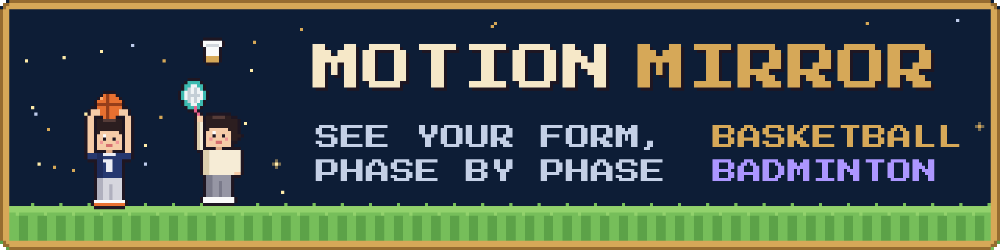
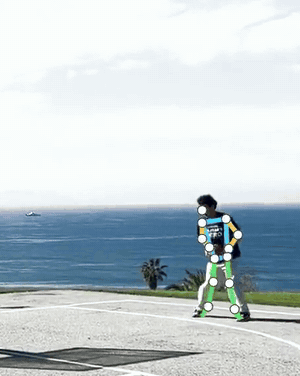
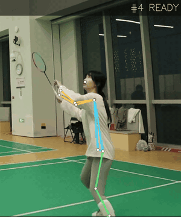
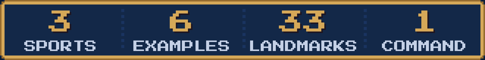
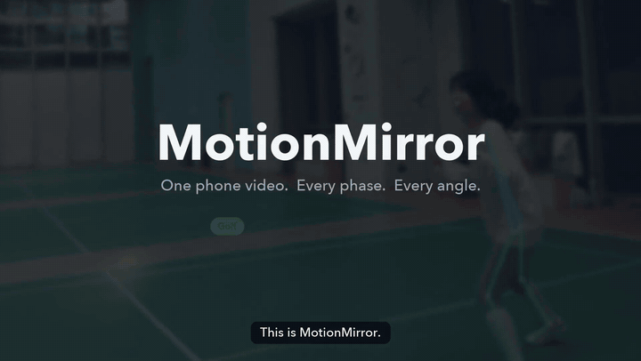
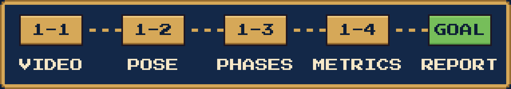
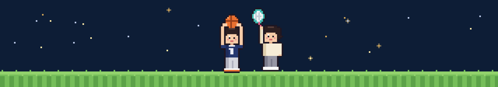

<p align="center">
  <a href="https://rayford295.github.io/motionmirror/"></a>
</p>

<p align="center">
  <a href="https://github.com/rayford295/motionmirror/actions/workflows/test.yml"></a>
  
  <a href="./LICENSE"></a>
  <br>
  <b>English</b> · <a href="README.zh-CN.md">中文</a> ·
  <a href="https://rayford295.github.io/motionmirror/"><b>▶ Website</b></a> ·
  <a href="https://youtu.be/Kd4xoJ1RMb0">Video</a> ·
  <a href="https://rayford295.github.io/motionmirror/viewer/pose3d.html">3D viewer</a>
</p>

<table>
<tr>
<td width="50%" align="center"><br><sub>🏀 <b>Jump shot</b> · 120 fps · auto-zoom</sub></td>
<td width="50%" align="center"><br><sub>🏸 <b>Badminton overhead</b> · contact detection</sub></td>
</tr>
</table>

**MotionMirror** turns one phone video of a jump shot or a badminton stroke into phases,
measurements and plain-language feedback. Every number traces back to a frame and a joint.




<p align="center">
  <a href="https://youtu.be/Kd4xoJ1RMb0"></a>
  <br><b><a href="https://youtu.be/Kd4xoJ1RMb0">▶ Watch the 2-minute video on YouTube</a></b>
</p>


<table>
<tr>
<th width="50%">🏀 Rayford · jump shot · <a href="examples/rayford-basketball/report.md">report</a></th>
<th width="50%">🏸 Chen Jingyi · 4 strokes · <a href="examples/chen-jingyi-badminton/report.md">report</a></th>
</tr>
<tr>
<td valign="top">

| Check | Value | |
| --- | --- | --- |
| Elbow at release | **176°** | ✅ |
| Knee bend in dip | **152°** | ✅ |
| Release height | **+0.52 torso** | ✅ |
| Dip → release | **0.37 s** | ✅ |
| Landing drift | **0.23 torso** | ✅ |

</td>
<td valign="top">

| Stroke | Type | In range |
| --- | --- | --- |
| 1 | drive | 🟥🟥 |
| 2 | overhead | 🟩🟩🟥🟥 |
| 3 | drive | 🟩🟩🟩 |
| 4 | overhead | 🟩🟩🟥🟥 |

</td>
</tr>
</table>




Metrics are read at the moment that matters (the dip, the release, the contact), checked
against a reference range, and explained in plain words. Tiny or contested athletes get an
auto-zoom pass and a primary-athlete tracker.


```bash
pip install -e ".[pose]"
motionmirror analyze my_shot.mov --sport basketball --side auto
motionmirror analyze rally.mp4   --sport badminton  --side auto
```

You get a report with feedback, a skeleton overlay video, key poses and a metrics CSV.
Results, examples and how it works: **[the website](https://rayford295.github.io/motionmirror/)**.
Metric definitions: [docs/metrics.md](docs/metrics.md).

<details>
<summary><b>Examples</b></summary>

<!-- examples-table:start -->
| Session | Sport | Clip | Pose frames | Reps | Report |
|---|---|---|---|---|---|
| [rayford-basketball](examples/rayford-basketball/) | 🏀 Basketball · 120 fps | 6.8 s · 1080×1920 | 706 / 820 | 1 shot | [report.md](examples/rayford-basketball/report.md) |
| [chen-jingyi-badminton](examples/chen-jingyi-badminton/) | 🏸 Badminton | 12.1 s · 1920×1080 | 364 / 364 | 4 strokes | [report.md](examples/chen-jingyi-badminton/report.md) |
| [yifan-basketball-0710](examples/yifan-basketball-0710/) | 🏀 Basketball · 1v1 | 56.1 s · 480×854 | 1592 / 1712 | 2 shots | [report.md](examples/yifan-basketball-0710/report.md) |
<!-- examples-table:end -->

</details>

<details>
<summary><b>CLI reference</b></summary>

```text
motionmirror analyze SOURCE [--sport golf|basketball|badminton] [--side right|left|auto]
                            [--out DIR] [--model lite|full|heavy|PATH] [--labels FILE]
                            [--no-render] [--ball-trail off|detect|proxy]
                            [--min-confidence 0-1] [--json]
motionmirror compare SESSION_A SESSION_B                       # same athlete, two sessions
motionmirror highlights LONG_VIDEO --session-id ID [--top-k 3]  # cut the best swings
motionmirror register VIDEO --sport badminton                      # private local manifest
```

</details>

<details>
<summary><b>Development</b></summary>

```bash
pip install -e ".[pose,dev]"
pytest -q && ruff check src tests tools
```

The pixel art is drawn in code: `python tools/promo/make_pixel_assets.py`.
See [CONTRIBUTING.md](CONTRIBUTING.md) and the [changelog](CHANGELOG.md).

</details>

<p align="center">
  
  <br><sub>MIT License · Formerly <i>SwingForm AI</i></sub>
</p>
