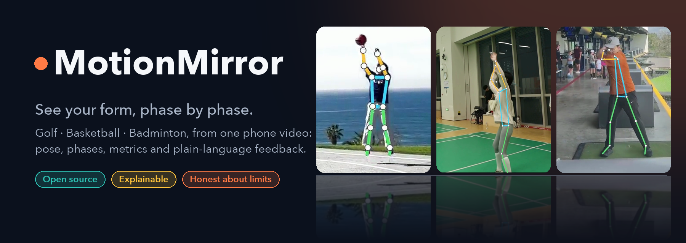

<p align="center">
  
</p>

<p align="center">
  <a href="https://github.com/rayford295/motionmirror/actions/workflows/test.yml"></a>
  
  
  <a href="./LICENSE"></a>
  <a href="https://rayford295.github.io/motionmirror/"></a>
  <a href="https://rayford295.github.io/motionmirror/viewer/pose3d.html"></a>
</p>

<p align="center">
  <b>English</b> · <a href="README.zh-CN.md">中文</a> ·
  <a href="https://rayford295.github.io/motionmirror/">Website</a> ·
  <a href="docs/metrics.md">Metrics</a> ·
  <a href="CHANGELOG.md">Changelog</a>
</p>

<p align="center">
  <a href="docs/assets/promo/motionmirror-promo.mp4"></a>
  <br><sub><b>▶ <a href="docs/assets/promo/motionmirror-promo.mp4">Watch the narrated promo</a></b></sub>
</p>

<table>
<tr>
<td width="50%" align="center"><br><sub>🏀 <b>Jump shot</b> · 120 fps · auto-zoom</sub></td>
<td width="50%" align="center"><br><sub>🏸 <b>Badminton overhead</b> · contact detection</sub></td>
</tr>
</table>

**MotionMirror** turns an ordinary phone video of a basketball jump shot or a badminton
stroke into phase-by-phase posture metrics, plain-language feedback and review
visuals. Every number traces back to a frame, a joint and a reference range.

```text
video ─► pose (33 landmarks) ─► reps + phases ─► metrics at each phase ─► feedback + report
```

## Highlights

<table>
<tr>
<td width="33%" valign="top">

**🎯 Phase-aware**<br>
Metrics are read at the moment that matters (the dip, the release, the contact), not
averaged over the whole clip.

</td>
<td width="33%" valign="top">

**💬 Explainable feedback**<br>
Each check shows the value, the reference range and a plain-language cue, so you can see why
a cue was raised.

</td>
<td width="33%" valign="top">

**🔍 Small or crowded scenes**<br>
An auto-zoom pass handles tiny athletes; a primary-athlete tracker and shot gate handle
1v1 gameplay.

</td>
</tr>
<tr>
<td valign="top">

**📐 Honest geometry**<br>
Aspect-corrected, image-plane angles; distances in torso lengths; hidden joints shown as
`n/a`, never guessed.

</td>
<td valign="top">

**🎬 Review-ready output**<br>
Overlay video, real-frame key-pose sheet, metric timeline, Markdown and JSON report, CSV.

</td>
<td valign="top">

**📈 You vs. you**<br>
`motionmirror compare` lines up two sessions of the same sport, per rep and per metric.

</td>
</tr>
</table>

## Quickstart

```bash
pip install -e ".[pose]"

motionmirror analyze my_shot.mov --sport basketball --side auto --out runs/court-day
motionmirror analyze rally.mp4   --sport badminton  --side auto
```

```text
badminton: 4 rep(s), side=right
  rep 4: 50% in range (confidence 0.83)
    - Arm extension at contact: Hitting with a bent arm; reach up and strike at full extension.
    - Contact height: Contact is low for an overhead; take the shuttle earlier, above the head.
Wrote:
  runs/court-day/pose.json  metrics.csv  report.json  report.md  overlay.mp4  timeline.png  keyposes.jpg
```

Already have landmarks? `motionmirror analyze pose.json --sport badminton` needs no video
dependencies at all. The old `swingform` command still works as an alias.

## Flagship Demos

### 🏀 Basketball · Rayford, oceanside jump shot

The shooter fills only **9% of a 1080×1920, 120 fps frame**. MotionMirror locates him, zooms in
for a second pose pass, and splits the shot into six phases.


| Check | Value | Reference | |
| --- | --- | --- | --- |
| Elbow extension at release | **176°** | ≥ 145° | ✅ |
| Knee bend in the dip | **152°** | 95° to 160° | ✅ |
| Release height above head | **+0.52 torso** | ≥ 0.2 | ✅ |
| Dip-to-release time | **0.37 s** | 0.2 to 0.8 s | ✅ |
| Sideways drift on landing | **0.23 torso** | ≤ 0.5 | ✅ |

[Report](examples/rayford-basketball/report.md) · [Overlay video](examples/rayford-basketball/overlay.mp4) · [Timeline](examples/rayford-basketball/timeline.png)

### 🏸 Badminton · Chen Jingyi (陈静仪), drives and overheads

The badminton profile finds **4 strokes in 12 s** from racket-hand speed, classifies each as
**drive** or **overhead**, and applies stroke-specific checks. On overheads, contact is placed
at the top of the reach, because the arm keeps accelerating after the hit.


| Stroke | Type | Checks in range | Main cue |
| --- | --- | --- | --- |
| #1 | drive | 0 / 2 | Long, slow preparation; ready stance very low |
| #2 | overhead | 2 / 4 | Contact low for an overhead; raise the free arm |
| #3 | drive | 3 / 3 | ✅ All in range |
| #4 | overhead | 2 / 4 | Strike at full extension; take the shuttle earlier |

[Report](examples/chen-jingyi-badminton/report.md) · [Overlay video](examples/chen-jingyi-badminton/overlay.mp4) · [Timeline](examples/chen-jingyi-badminton/timeline.png)

## What It Measures

| | 🏀 Basketball | 🏸 Badminton |
| --- | --- | --- |
| **Phases** | set · dip · lift · release · follow-through · landing | ready · backswing · contact · follow-through · recovery |
| **Angles** | shooting elbow, knees | racket-arm extension, ready-stance knees |
| **Position** | release height, guide-hand gap, landing drift | contact height, free-arm height, base width |
| **Timing** | set-to-release, dip-to-release | backswing-to-contact, recovery, peak hand speed |
| **Extras** | hands-together shot gate for 1v1 | stroke type: overhead / drive / underhand |

Definitions, units and the reasoning behind every reference range: [docs/metrics.md](docs/metrics.md).
A golf profile (`--sport golf`) also ships and is documented there.

## Examples

Every artifact was produced by `motionmirror analyze` from the clip in the same folder. The
table is generated from the committed reports (`python tools/generate_examples_table.py`).

<!-- examples-table:start -->
| Session | Sport | Clip | Pose frames | Reps | Report |
|---|---|---|---|---|---|
| [rayford-basketball](examples/rayford-basketball/) | 🏀 Basketball · 120 fps | 6.8 s · 1080×1920 | 706 / 820 | 1 shot | [report.md](examples/rayford-basketball/report.md) |
| [chen-jingyi-badminton](examples/chen-jingyi-badminton/) | 🏸 Badminton | 12.1 s · 1920×1080 | 364 / 364 | 4 strokes | [report.md](examples/chen-jingyi-badminton/report.md) |
| [yifan-basketball-0710](examples/yifan-basketball-0710/) | 🏀 Basketball · 1v1 | 56.1 s · 480×854 | 1592 / 1712 | 2 shots | [report.md](examples/yifan-basketball-0710/report.md) |
<!-- examples-table:end -->

Compare two sessions of the same sport with `motionmirror compare examples/<a> examples/<b>`.

## How It Stays Honest

- **Aspect-correct geometry.** MediaPipe normalizes x by width and y by height; angles are
  computed after undoing that, so portrait phone clips are not distorted.
- **Image-plane angles.** Monocular depth swings a knee angle by 20° frame to frame, so angles
  use 2D geometry by default.
- **Gaps are not crashes.** Hidden joints become `n/a`, short dropouts are interpolated, and
  each phase value is a 5-frame median.
- **Confidence on every rep**, with the reason whenever it drops.
- **Known limit.** In close 1v1 contact the tracker can switch players; appearance-based
  re-identification is on the roadmap.

Auto-detection is heuristic. When a phase is wrong, pass hand-marked times with
`--labels labels.json`.

<details>
<summary><b>CLI reference</b></summary>

```text
motionmirror analyze SOURCE [--sport golf|basketball|badminton] [--side right|left|auto]
                            [--out DIR] [--model lite|full|heavy|PATH] [--labels FILE]
                            [--no-render] [--ball-trail off|detect|proxy]
                            [--min-confidence 0-1] [--json]
motionmirror compare SESSION_A SESSION_B                       # same athlete, two sessions
motionmirror highlights LONG_VIDEO --session-id ID [--top-k 3]  # cut the best swings
motionmirror register VIDEO --sport badminton                      # private local manifest
```

</details>

<details>
<summary><b>Python API</b></summary>

```python
from motionmirror.schema import PoseSequence
from motionmirror.analysis import analyze_sequence

analysis = analyze_sequence(PoseSequence.load("pose.json"), sport="badminton", side="auto")
for summary, findings in zip(analysis.summaries, analysis.findings):
    print(summary["stroke"], [(f.label, f.status) for f in findings])
```

</details>

<details>
<summary><b>Project map</b></summary>

```text
src/motionmirror/
  schema.py           pose data model (aspect-aware, visibility-gated)
  signal.py           gap filling, smoothing, peak finding (pure Python)
  profiles/           golf.py · basketball.py · badminton.py
  feedback.py         reference-range checks, scoring, consistency
  analysis.py         pose sequence -> reps -> summaries -> report
  video.py            video I/O, MediaPipe pose, auto-zoom pass
  tracking.py         primary-athlete selection in multi-person scenes
  ball_tracking.py    tee-anchored, quality-gated golf ball trail
  render.py           overlay video, key-pose sheet, timeline
  compare.py          cross-session comparison
  pipeline.py · cli.py
tools/                promo video, README banner, examples table
tests/                synthetic swings, shots and strokes with known phase times
docs/                 website, 3D viewer, metrics, architecture
```

</details>

## Development

```bash
pip install -e ".[pose,dev]"
pytest -q && ruff check src tests tools
```

Core tests need no video stack; CI also runs an end-to-end smoke test on a bundled clip.
Contributions are welcome; see [CONTRIBUTING.md](CONTRIBUTING.md).

<p align="center"><sub>MIT License · Formerly <i>SwingForm AI</i></sub></p>
