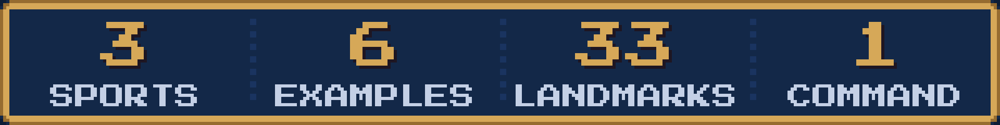
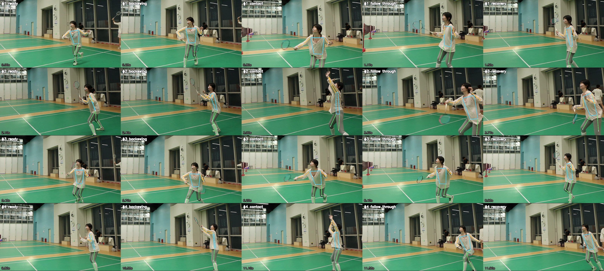

<p align="center">
  <a href="https://rayford295.github.io/motionmirror/"></a>
</p>

<p align="center">
  <a href="https://github.com/rayford295/motionmirror/actions/workflows/test.yml"></a>
  
  <a href="./LICENSE"></a>
</p>

<p align="center">
  <a href="README.md">English</a> · <b>中文</b> ·
  <a href="https://rayford295.github.io/motionmirror/"><b>▶ 网站</b></a> ·
  <a href="https://youtu.be/Kd4xoJ1RMb0">视频</a> ·
  <a href="https://rayford295.github.io/motionmirror/viewer/pose3d.html">3D 查看器</a> ·
  <a href="docs/metrics.md">指标说明</a>
</p>

<table>
<tr>
<td width="50%" align="center"><br><sub>🏀 <b>跳投</b> · 120 fps · 自动放大</sub></td>
<td width="50%" align="center"><br><sub>🏸 <b>羽毛球高手击球</b> · 击球点识别</sub></td>
</tr>
</table>

**MotionMirror（动作镜像）** 把一段普通手机拍摄的篮球跳投或羽毛球击球视频，转换成分阶段的姿态指标、
通俗易懂的反馈和可回看的可视化结果。每一个数字都能追溯到具体的帧、关节和参考区间。

<p align="center">
  
</p>


## 两分钟看懂

<p align="center">
  <a href="https://youtu.be/Kd4xoJ1RMb0"></a>
  <br><b><a href="https://youtu.be/Kd4xoJ1RMb0">▶ 在 YouTube 观看完整英文配音版视频（2:08，有声音）</a></b>
  <br><sub>封面：<a href="docs/assets/promo/cover-pixel.png">横版</a> · <a href="docs/assets/promo/cover-pixel-vertical.png">竖版</a></sub>
</p>


## 真实结果

### 🏀 篮球：Rayford 海边跳投

投篮者只占 1080×1920、120 fps 画面高度的 **9%**。MotionMirror 先定位人物，再放大做第二遍姿态识别，
并把投篮拆成六个阶段。


| 检查项 | 数值 | 参考区间 | |
| --- | --- | --- | --- |
| 出手时肘部伸展 | **176°** | ≥ 145° | ✅ |
| 下蹲时膝盖弯曲 | **152°** | 95° 至 160° | ✅ |
| 出手点高于头顶 | **+0.52 个躯干长度** | ≥ 0.2 | ✅ |
| 下蹲到出手时间 | **0.37 秒** | 0.2 至 0.8 秒 | ✅ |
| 落地横向漂移 | **0.23 个躯干长度** | ≤ 0.5 | ✅ |

[报告](examples/rayford-basketball/report.md) · [叠加视频](examples/rayford-basketball/overlay.mp4) · [时间线](examples/rayford-basketball/timeline.png)

### 🏸 羽毛球：陈静仪，平抽与高手击球

羽毛球分析在 12 秒内识别出 **4 次击球**，自动分为**平抽**和**高手击球**，并按击球类型给出建议。
高手击球的击球点取手臂伸到最高的那一帧，因为击球后手臂还会继续加速向下。



| 击球 | 类型 | 达标项 | 主要建议 |
| --- | --- | --- | --- |
| 1 | 平抽 | 🟥🟥 0 / 2 | 准备动作过长过慢；准备姿势过低 |
| 2 | 高手 | 🟩🟩🟥🟥 2 / 4 | 高手击球的击球点偏低；抬高非持拍手 |
| 3 | 平抽 | 🟩🟩🟩 3 / 3 | ✅ 全部达标 |
| 4 | 高手 | 🟩🟩🟥🟥 2 / 4 | 在手臂完全伸展时击球；更早迎球 |

[报告](examples/chen-jingyi-badminton/report.md) · [叠加视频](examples/chen-jingyi-badminton/overlay.mp4) · [时间线](examples/chen-jingyi-badminton/timeline.png)


## 如何保证结果可信

| | |
| --- | --- |
| 🎯 **按阶段测量** | 在关键时刻读取指标（下蹲、出手、击球点），而不是整段平均 |
| 💬 **可解释的反馈** | 每项检查都给出数值、参考区间和通俗建议 |
| 🔍 **小目标与多人场景** | 人物太小时自动放大；1v1 对抗中锁定主运动员并过滤防守动作 |
| 📐 **诚实的几何计算** | 宽高比校正、2D 角度、以躯干长度为单位；看不到的关节标为 n/a |
| 🎬 **可直接回看** | 叠加视频、真实关键帧、指标时间线、报告与 CSV |
| 📈 **自己和自己比** | `motionmirror compare` 对比同一运动的两次训练 |

- **宽高比校正**：MediaPipe 的 x 按宽度、y 按高度归一化，计算角度前先还原，竖屏视频不会失真。
- **图像平面角度**：单目深度 z 噪声很大，会让膝盖角度跳动 20°，因此默认使用 2D 几何。
- **与尺度无关的距离**：位移以“躯干长度”为单位，不受拍摄远近影响。
- **缺帧不崩溃**：被遮挡的关节记为 n/a，短暂缺失会插值，阶段值取 5 帧中位数。
- **每次动作都有置信度**：可见度低或时间不合理时置信度降低，并在报告中说明原因。
- **已知局限**：1v1 近身对抗时追踪可能切换到另一名球员；基于外观的重识别已列入路线图。

自动检测基于启发式规则。若某个阶段判断有误，可用 `--labels labels.json` 提供人工标注时间。


## 工作原理

<p align="center">
  
</p>

**篮球**（持球 → 下蹲 → 上提 → 出手 → 随球 → 落地）：出手时肘部伸展、下蹲时膝盖弯曲、
出手高度（高于头部多少）、下蹲到出手时间、辅助手间距、落地横向漂移。

**羽毛球**（准备 → 引拍 → 击球 → 随挥 → 回位，每次击球自动分为高手/平抽/低手）：击球时手臂伸展与击球高度、
非持拍手位置、持拍手峰值速度、准备姿势膝盖弯曲、击球时站位宽度、引拍节奏。

各指标的定义、单位和参考区间的依据见 [docs/metrics.md](docs/metrics.md)。项目同时保留高尔夫分析（`--sport golf`），说明也在该文档中。


## 示例

下表由各示例的 `report.json` 自动生成（`python tools/generate_examples_table.py`）。

<!-- examples-table:start -->
| Session | Sport | Clip | Pose frames | Reps | Report |
|---|---|---|---|---|---|
| [rayford-basketball](examples/rayford-basketball/) | 🏀 Basketball · 120 fps | 6.8 s · 1080×1920 | 706 / 820 | 1 shot | [report.md](examples/rayford-basketball/report.md) |
| [chen-jingyi-badminton](examples/chen-jingyi-badminton/) | 🏸 Badminton | 12.1 s · 1920×1080 | 364 / 364 | 4 strokes | [report.md](examples/chen-jingyi-badminton/report.md) |
| [yifan-basketball-0710](examples/yifan-basketball-0710/) | 🏀 Basketball · 1v1 | 56.1 s · 480×854 | 1592 / 1712 | 2 shots | [report.md](examples/yifan-basketball-0710/report.md) |
<!-- examples-table:end -->

更多示例（包括高尔夫）见[网站的选关页](https://rayford295.github.io/motionmirror/#examples)。


## 自己和自己比

每次训练都导出同一套指标，所以同一运动的任意两次训练都能逐次、逐项对比：

```bash
motionmirror compare examples/yifan-golf-0520 examples/yifan-golf-0601
```

完整对比报告见 [这里](docs/examples/compare-yifan-golf-0520-vs-yifan-golf-0601.md)。


## 快速开始

```bash
pip install -e ".[pose]"

motionmirror analyze my_shot.mov  --sport basketball --side auto
motionmirror analyze rally.mp4    --sport badminton  --side auto
```

输出文件夹包含：

| 文件 | 内容 |
| --- | --- |
| `report.md` / `report.json` | 每次动作的阶段、节奏、指标、参考区间检查、多次动作一致性 |
| `overlay.mp4` | 骨架、残影、阶段标签和实时关节角度（H.264，浏览器可直接播放） |
| `keyposes.jpg` | 每个阶段的真实画面，每次动作一行 |
| `timeline.png` | 手部/手腕信号与角度曲线，标注各阶段 |
| `metrics.csv` | 逐帧指标，带阶段标记 |
| `pose.json` | 原始关键点，可不重跑姿态模型直接再分析 |

已经有关键点数据？`motionmirror analyze pose.json --sport badminton` 不需要任何视频依赖。


## 开发

```bash
pip install -e ".[pose,dev]"
pytest -q && ruff check src tests tools
```

README 和网站上的像素画都由代码绘制：`python tools/promo/make_pixel_assets.py`。

<p align="center">
  
  <br><sub><a href="https://rayford295.github.io/motionmirror/">网站</a> · <a href="https://rayford295.github.io/motionmirror/viewer/pose3d.html">3D 查看器</a> · <a href="README.md">English</a> · MIT License · 原名 <i>SwingForm AI</i></sub>
</p>
