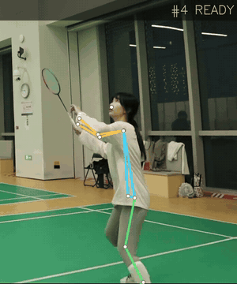
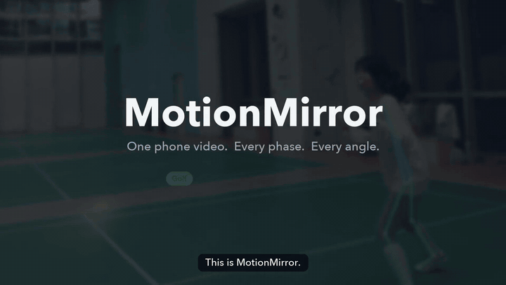

<p align="center">
  <a href="https://rayford295.github.io/motionmirror/"></a>
</p>

<p align="center">
  <a href="https://github.com/rayford295/motionmirror/actions/workflows/test.yml"></a>
  
  <a href="./LICENSE"></a>
  <br>
  <a href="README.md">English</a> · <b>中文</b> ·
  <a href="https://rayford295.github.io/motionmirror/"><b>▶ 网站</b></a> ·
  <a href="https://youtu.be/Kd4xoJ1RMb0">视频</a> ·
  <a href="https://rayford295.github.io/motionmirror/viewer/pose3d.html">3D 查看器</a>
</p>

<table>
<tr>
<td width="50%" align="center"><br><sub>🏀 <b>跳投</b> · 120 fps · 自动放大</sub></td>
<td width="50%" align="center"><br><sub>🏸 <b>羽毛球高手击球</b> · 击球点识别</sub></td>
</tr>
</table>

**MotionMirror（动作镜像）** 把一段手机拍的篮球跳投或羽毛球击球视频，变成分阶段的测量和通俗的建议。
每个数字都能追溯到具体的帧和关节。


<p align="center">
  <a href="https://youtu.be/Kd4xoJ1RMb0"></a>
  <br><b><a href="https://youtu.be/Kd4xoJ1RMb0">▶ 在 YouTube 观看两分钟介绍视频</a></b>
</p>


<table>
<tr>
<th width="50%">🏀 Rayford · 跳投 · <a href="examples/rayford-basketball/report.md">报告</a></th>
<th width="50%">🏸 陈静仪 · 4 次击球 · <a href="examples/chen-jingyi-badminton/report.md">报告</a></th>
</tr>
<tr>
<td valign="top">

| 检查项 | 数值 | |
| --- | --- | --- |
| 出手时肘部伸展 | **176°** | ✅ |
| 下蹲时膝盖弯曲 | **152°** | ✅ |
| 出手点高于头顶 | **+0.52 躯干** | ✅ |
| 下蹲到出手 | **0.37 秒** | ✅ |
| 落地横向漂移 | **0.23 躯干** | ✅ |

</td>
<td valign="top">

| 击球 | 类型 | 达标项 |
| --- | --- | --- |
| 1 | 平抽 | 🟥🟥 |
| 2 | 高手 | 🟩🟩🟥🟥 |
| 3 | 平抽 | 🟩🟩🟩 |
| 4 | 高手 | 🟩🟩🟥🟥 |

</td>
</tr>
</table>


在关键时刻（下蹲、出手、击球点）读取指标，与参考区间对比，并用通俗的话解释。
人物太小或多人对抗时，会自动放大并锁定主运动员。


```bash
pip install -e ".[pose]"
motionmirror analyze my_shot.mov --sport basketball --side auto
motionmirror analyze rally.mp4   --sport badminton  --side auto
```

输出包括带建议的报告、骨架叠加视频、关键姿态图和指标 CSV。
效果、示例和原理见 **[网站](https://rayford295.github.io/motionmirror/)**；指标说明见 [docs/metrics.md](docs/metrics.md)。

<details>
<summary><b>示例</b></summary>

<!-- examples-table:start -->
| Session | Sport | Clip | Pose frames | Reps | Report |
|---|---|---|---|---|---|
| [rayford-basketball](examples/rayford-basketball/) | 🏀 Basketball · 120 fps | 6.8 s · 1080×1920 | 706 / 820 | 1 shot | [report.md](examples/rayford-basketball/report.md) |
| [chen-jingyi-badminton](examples/chen-jingyi-badminton/) | 🏸 Badminton | 12.1 s · 1920×1080 | 364 / 364 | 4 strokes | [report.md](examples/chen-jingyi-badminton/report.md) |
| [yifan-basketball-0710](examples/yifan-basketball-0710/) | 🏀 Basketball · 1v1 | 56.1 s · 480×854 | 1592 / 1712 | 2 shots | [report.md](examples/yifan-basketball-0710/report.md) |
<!-- examples-table:end -->

</details>

<details>
<summary><b>开发</b></summary>

```bash
pip install -e ".[pose,dev]"
pytest -q && ruff check src tests tools
```

像素画由代码绘制：`python tools/promo/make_pixel_assets.py`。

</details>

<p align="center">
  
  <br><sub>MIT License · 原名 <i>SwingForm AI</i></sub>
</p>
