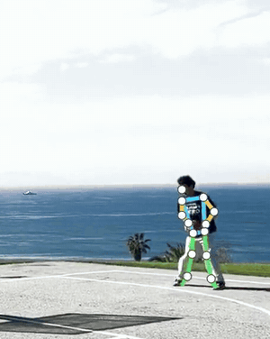
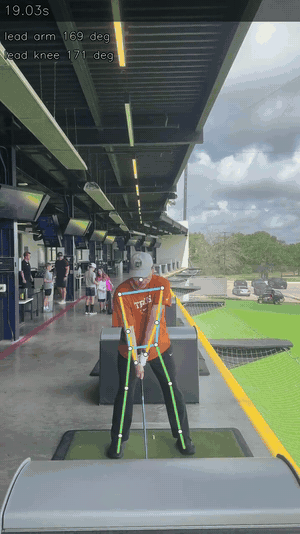
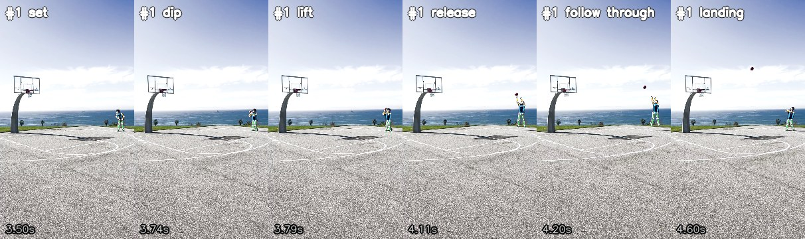

<p align="center">
  
</p>

<p align="center">
  <a href="https://github.com/rayford295/motionmirror/actions/workflows/test.yml"></a>
  
  
  <a href="./LICENSE"></a>
  <a href="https://rayford295.github.io/motionmirror/"></a>
</p>

<p align="center">
  <a href="README.md">English</a> · <b>中文</b> ·
  <a href="https://rayford295.github.io/motionmirror/">网站</a> ·
  <a href="docs/metrics.md">指标说明</a>
</p>

<!-- PROMO (enabled once the narrated video is rendered)
<p align="center">
  <a href="docs/assets/promo/motionmirror-promo.mp4"></a>
  <br><sub><b>▶ <a href="docs/assets/promo/motionmirror-promo.mp4">观看英文配音宣传片</a></b></sub>
</p>
-->

<table>
<tr>
<td width="33%" align="center"><br><sub>🏀 <b>跳投</b> · 120 fps · 自动放大</sub></td>
<td width="33%" align="center"><br><sub>🏸 <b>羽毛球高手击球</b> · 击球点识别</sub></td>
<td width="33%" align="center"><br><sub>⛳ <b>高尔夫挥杆</b> · TopGolf · 挥杆阶段</sub></td>
</tr>
</table>

**MotionMirror（动作镜像）** 把一段普通手机拍摄的高尔夫挥杆、篮球跳投或羽毛球击球视频，转换成分阶段的姿态指标、
通俗易懂的反馈和可回看的可视化结果。每一个数字都能追溯到具体的帧、关节和参考区间。

```
视频 ─► 姿态（MediaPipe，33 个关键点）─► 动作次数 + 阶段 ─► 各阶段指标 ─► 反馈 + 报告
```

## 亮点

| | |
| --- | --- |
| 🎯 **按阶段测量** | 在关键时刻读取指标（上杆顶点、出手、击球点），而不是整段平均 |
| 💬 **可解释的反馈** | 每项检查都给出数值、参考区间和通俗建议 |
| 🔍 **小目标与多人场景** | 人物太小时自动放大；1v1 对抗中锁定主运动员并过滤防守动作 |
| 📐 **诚实的几何计算** | 宽高比校正、2D 角度、以躯干长度为单位；看不到的关节标为 n/a |
| 🎬 **可直接回看** | 叠加视频、真实关键帧、指标时间线、报告与 CSV |
| 📈 **自己和自己比** | `motionmirror compare` 对比同一运动的两次训练 |

## 旗舰演示

### 篮球：Rayford 海边跳投

投篮者只占 1080×1920、120 fps 画面高度的 **9%**。MotionMirror 先定位人物，再放大做第二遍姿态识别，
并把投篮拆成六个阶段。出手时肘部伸展 **176°**，出手点高于头顶 **0.52 个躯干长度**，
下蹲到出手 **0.37 秒**，五项检查全部在参考区间内。



### 羽毛球：陈静仪

全新的羽毛球分析在 12 秒内识别出 **4 次击球**，自动分为**平抽**和**高手击球**，并按击球类型给出建议。
高手击球的击球点取手臂伸到最高的那一帧，因为击球后手臂还会继续加速向下。


## 快速开始

```bash
pip install -e ".[pose]"

motionmirror analyze my_swing.mp4 --sport golf --out runs/range-day
motionmirror analyze my_shot.mov  --sport basketball --side auto
motionmirror analyze rally.mp4    --sport badminton  --side auto
```

输出文件夹包含：

| 文件 | 内容 |
| --- | --- |
| `report.md` / `report.json` | 每次动作的阶段、节奏、指标、参考区间检查、多次动作一致性 |
| `overlay.mp4` | 骨架、残影、阶段标签和实时关节角度（H.264，浏览器可直接播放） |
| `keyposes.jpg` | 每个阶段的真实画面，每次动作一行 |
| `timeline.png` | 手部/手腕信号与角度曲线，标注各阶段 |
| `metrics.csv` | 逐帧指标，带阶段标记 |
| `pose.json` | 原始关键点，可不重跑姿态模型直接再分析 |

已经有关键点数据？`motionmirror analyze pose.json --sport golf` 不需要任何视频依赖。

## 测量内容

**高尔夫**（准备 → 顶点 → 击球 → 收杆）：节奏比、上杆/下杆时间、顶点时前臂角度、手部高度、
髋部侧移、击球时头部位移、膝盖弯曲、站位宽度、肩髋分离、手部峰值速度。

**篮球**（持球 → 下蹲 → 上提 → 出手 → 随球 → 落地）：出手时肘部伸展、下蹲时膝盖弯曲、
出手高度（高于头部多少）、下蹲到出手时间、辅助手间距、落地横向漂移。

**羽毛球**（准备 → 引拍 → 击球 → 随挥 → 回位，每次击球自动分为高手/平抽/低手）：击球时手臂伸展与击球高度、
非持拍手位置、持拍手峰值速度、准备姿势膝盖弯曲、击球时站位宽度、引拍节奏。

各指标的定义、单位和参考区间的依据见 [docs/metrics.md](docs/metrics.md)。

## 如何保证结果可信

- **宽高比校正**：MediaPipe 的 x 按宽度、y 按高度归一化，计算角度前先还原，竖屏视频不会失真。
- **图像平面角度**：单目深度 z 噪声很大，会让膝盖角度跳动 20°，因此默认使用 2D 几何。
- **与尺度无关的距离**：位移以“躯干长度”为单位，不受拍摄远近影响。
- **缺帧不崩溃**：被遮挡的关节记为 n/a，短暂缺失会插值，阶段值取 5 帧中位数。
- **每次动作都有置信度**：可见度低或时间不合理时置信度降低，并在报告中说明原因。
- **不虚构球路**：只有真正检测到上升的抛物线轨迹时才画球迹（`--ball-trail detect`）；
  `--ball-trail proxy` 画出的虚线弧只是示意，不是测量值。不估计球速、发射角、转速、
  飞行距离或命中与否。

自动检测基于启发式规则。若某个阶段判断有误，可用 `--labels labels.json` 提供人工标注时间
（示例见 [examples/golf-swing-demo/labels.json](examples/golf-swing-demo/labels.json)）。

## 示例

下表由各示例的 `report.json` 自动生成（`python tools/generate_examples_table.py`）。

<!-- examples-table:start -->
| Session | Sport | Clip | Pose frames | Reps | Report |
|---|---|---|---|---|---|
| [rayford-basketball](examples/rayford-basketball/) | 🏀 Basketball · 120 fps | 6.8 s · 1080×1920 | 706 / 820 | 1 shot | [report.md](examples/rayford-basketball/report.md) |
| [chen-jingyi-badminton](examples/chen-jingyi-badminton/) | 🏸 Badminton | 12.1 s · 1920×1080 | 364 / 364 | 4 strokes | [report.md](examples/chen-jingyi-badminton/report.md) |
| [yifan-basketball-0710](examples/yifan-basketball-0710/) | 🏀 Basketball · 1v1 | 56.1 s · 480×854 | 1592 / 1712 | 2 shots | [report.md](examples/yifan-basketball-0710/report.md) |
| [yifan-golf-0601](examples/yifan-golf-0601/) | ⛳ Golf | 26.9 s · 720×1280 | 801 / 809 | 2 swings | [report.md](examples/yifan-golf-0601/report.md) |
| [yifan-golf-0520](examples/yifan-golf-0520/) | ⛳ Golf | 7.2 s · 320×568 | 216 / 216 | 2 swings | [report.md](examples/yifan-golf-0520/report.md) |
| [golf-swing-demo](examples/golf-swing-demo/) | ⛳ Golf | 14.4 s · 320×568 | 361 / 361 | 2 swings | [report.md](examples/golf-swing-demo/report.md) |
<!-- examples-table:end -->

跨场次对比：[yifan-golf-0520 vs yifan-golf-0601](docs/examples/compare-yifan-golf-0520-vs-yifan-golf-0601.md)，
可用 `motionmirror compare examples/<a> examples/<b>` 生成自己的对比。

## 开发

```bash
pip install -e ".[pose,dev]"
pytest -q && ruff check src tests
```

---

[网站](https://rayford295.github.io/motionmirror/) · [3D 查看器](https://rayford295.github.io/motionmirror/viewer/pose3d.html) · [English](README.md) · MIT License

<p align="center"><sub>MIT License · 原名 <i>SwingForm AI</i></sub></p>
