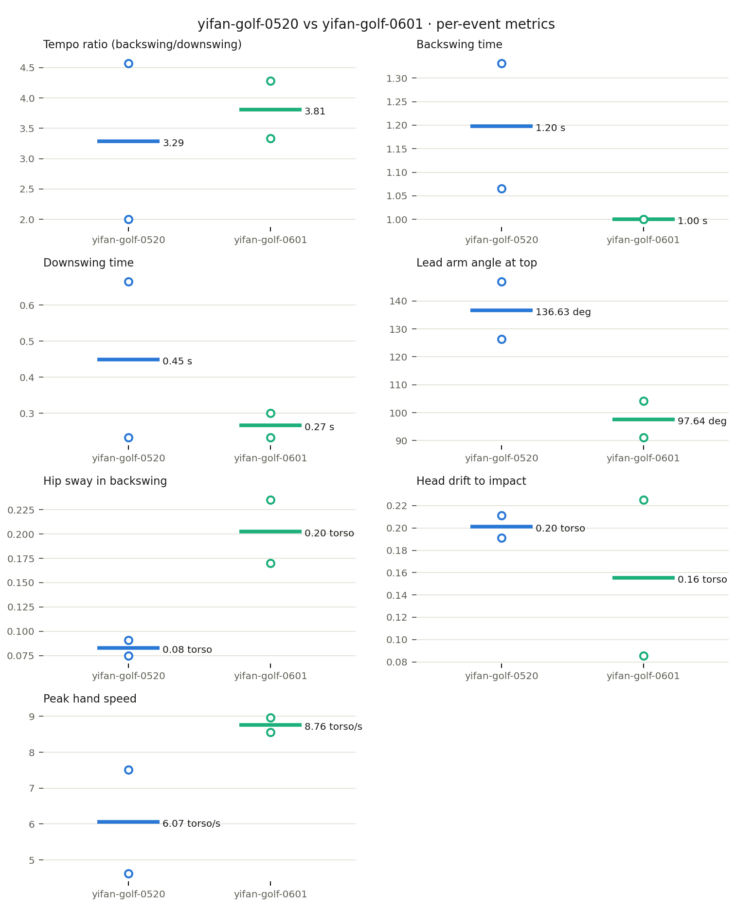

# Session Comparison: yifan-golf-0520 vs yifan-golf-0601

Same athlete, same sport (golf), two sessions. Values are per-swing means; open dots on the chart are individual events.

| Metric | yifan-golf-0520 | yifan-golf-0601 | Delta |
| --- | ---: | ---: | ---: |
| Tempo ratio (backswing/downswing) | 3.29 | 3.81 | +0.52 |
| Backswing time | 1.20 s | 1.00 s | -0.20 s |
| Downswing time | 0.45 s | 0.27 s | -0.18 s |
| Lead arm angle at top | 136.63 deg | 97.64 deg | -38.99 deg |
| Hip sway in backswing | 0.08 torso | 0.20 torso | +0.12 torso |
| Head drift to impact | 0.20 torso | 0.16 torso | -0.05 torso |
| Peak hand speed | 6.07 torso/s | 8.76 torso/s | +2.69 torso/s |

## Sessions

| | yifan-golf-0520 | yifan-golf-0601 |
| --- | --- | --- |
| Events | 2 | 2 |
| Duration | 7.2s | 26.9s |
| Resolution | 320x568 | 720x1280 |
| Pose coverage | 100.0% | 99.0% |

## Limitations

- Single-camera pose proxies; camera angle and distance differ between sessions, so cross-session deltas are directional, not calibrated measurements.
- Metrics compare only events the detector isolated in both sessions.
