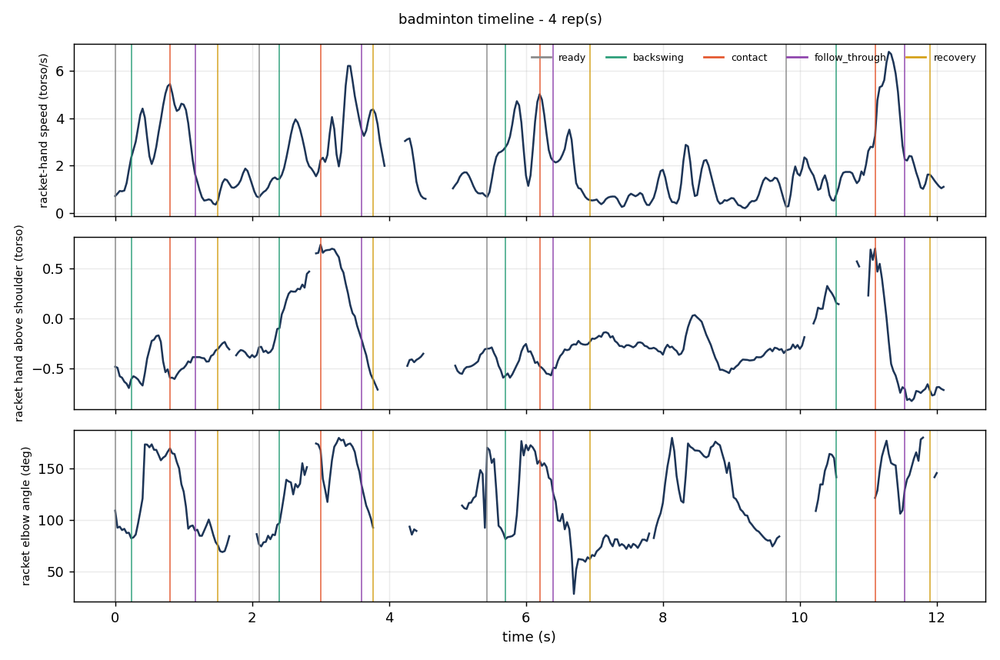
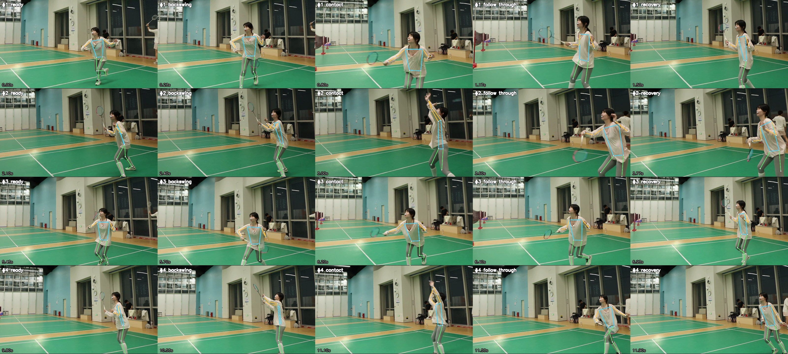

# MotionMirror report: badminton (badminton.mp4)

*motionmirror 0.2.0* | side: **right** | reps detected: **4**

## Capture quality

| Duration | FPS | Resolution | Pose coverage | Mean visibility |
| --- | --- | --- | --- | --- |
| 12 s | 30 | 1920x1080 | 100% | 0.87 |

> **Note:** side=auto picked 'right' (fastest-moving hand).

Overlay video: [overlay.mp4](overlay.mp4)

## Rep 1 - 0% of checks in range

Phases: ready 0.00s, backswing 0.23s, contact 0.80s, follow_through 1.17s, recovery 1.50s  
Detection confidence: 0.85 (auto)

- stroke type: drive
Timing: backswing to contact s 0.57, contact to recovery s 0.70

| Check | Value | Reference | Status | Cue |
| --- | --- | --- | --- | --- |
| Backswing-to-contact time | 0.57 s | 0.08 - 0.5 | HIGH | Long, slow swing; a compact preparation is easier to time. |
| Base width at contact | n/a | >= 0.7 | n/a | Not measurable in this clip (joint hidden or phase missing). |
| Ready-position knee bend | 88 deg | 115 - 165 | LOW | Very low ready stance; it can slow your first step. |

## Rep 2 - 50% of checks in range

Phases: ready 2.10s, backswing 2.40s, contact 3.00s, follow_through 3.60s, recovery 3.77s  
Detection confidence: 0.58 (auto)

- stroke type: overhead
- backswing-to-contact 0.60s is outside 0.05-0.6s
Timing: backswing to contact s 0.60, contact to recovery s 0.77

| Check | Value | Reference | Status | Cue |
| --- | --- | --- | --- | --- |
| Arm extension at contact | 168 deg | >= 150 | OK |  |
| Contact height | 0.66 torso | >= 0.8 | LOW | Contact is low for an overhead; take the shuttle earlier, above the head. |
| Non-racket arm raised | -0.04 torso | >= 0 | LOW | Non-racket arm stays low; raise it to aim and to balance the rotation. |
| Ready-position knee bend | 131 deg | 115 - 165 | OK |  |

## Rep 3 - 100% of checks in range

Phases: ready 5.43s, backswing 5.70s, contact 6.20s, follow_through 6.40s, recovery 6.93s  
Detection confidence: 0.89 (auto)

- stroke type: drive
Timing: backswing to contact s 0.50, contact to recovery s 0.73

| Check | Value | Reference | Status | Cue |
| --- | --- | --- | --- | --- |
| Backswing-to-contact time | 0.50 s | 0.08 - 0.5 | OK |  |
| Base width at contact | 0.95 torso | >= 0.7 | OK |  |
| Ready-position knee bend | 130 deg | 115 - 165 | OK |  |

## Rep 4 - 50% of checks in range

Phases: ready 9.80s, backswing 10.53s, contact 11.10s, follow_through 11.53s, recovery 11.90s  
Detection confidence: 0.83 (auto)

- stroke type: overhead
Timing: backswing to contact s 0.57, contact to recovery s 0.80

| Check | Value | Reference | Status | Cue |
| --- | --- | --- | --- | --- |
| Arm extension at contact | 125 deg | >= 150 | LOW | Hitting with a bent arm; reach up and strike at full extension. |
| Contact height | 0.58 torso | >= 0.8 | LOW | Contact is low for an overhead; take the shuttle earlier, above the head. |
| Non-racket arm raised | 0.32 torso | >= 0 | OK |  |
| Ready-position knee bend | 149 deg | 115 - 165 | OK |  |

## Consistency across reps

| Metric | Mean | Std | Min | Max | n |
| --- | --- | --- | --- | --- | --- |
| contact.racket_elbow_angle_deg | 153 | 17 | 125 | 168 | 4 |
| contact.peak_hand_speed_torso_s | 5.87 | 0.69 | 5.02 | 6.81 | 4 |
| timing.backswing_to_contact_s | 0.56 | 0.04 | 0.50 | 0.60 | 4 |
| ready.knee_angle_deg | 125 | 22 | 88 | 149 | 4 |

## How to read this

Metrics are 2D single-camera pose proxies. Reference ranges are broad starter values for spotting outliers, not coaching verdicts. No club, ball-flight or make/miss measurement is performed.
Distances are in torso lengths (shoulder-midpoint to hip-midpoint), so they do not depend on resolution or zoom.
