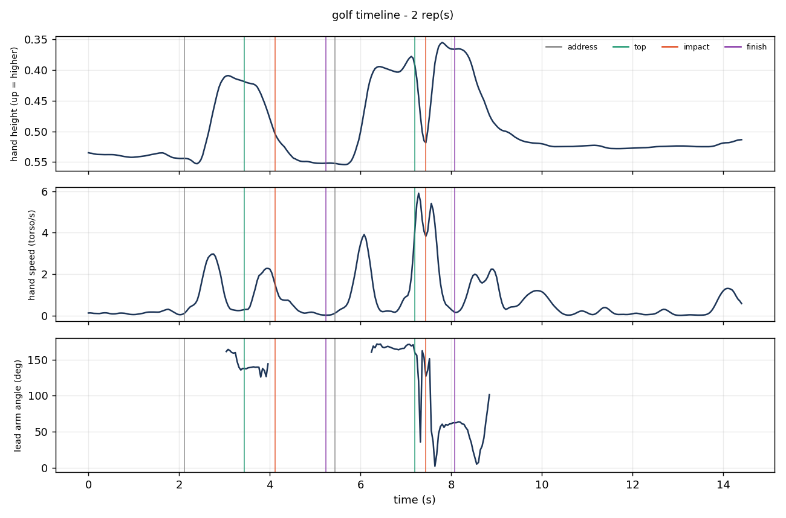
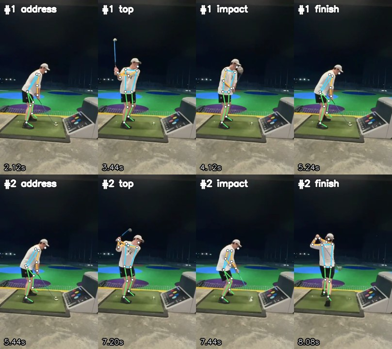

# SwingForm report: golf (golf.mp4)

*swingform-ai 0.2.0* | side: **right** | reps detected: **2**

## Capture quality

| Duration | FPS | Resolution | Pose coverage | Mean visibility |
| --- | --- | --- | --- | --- |
| 14 s | 25 | 320x568 | 100% | 0.82 |

> **Note:** Rep 1 ball trail: none
> **Note:** Rep 2 ball trail: none

Overlay video: [overlay.mp4](overlay.mp4)

## Rep 1 - 60% of checks in range

Phases: address 2.12s, top 3.44s, impact 4.12s, finish 5.24s  
Detection confidence: 0.50 (auto)

- downswing 0.68s is outside the usual 0.12-0.6s window
Timing: backswing s 1.32, downswing s 0.68, tempo ratio 1.94, total s 3.12

| Check | Value | Reference | Status | Cue |
| --- | --- | --- | --- | --- |
| Tempo (backswing : downswing) | 1.94:1 | 2 - 4 | LOW | Backswing is quick relative to the downswing; try a smoother, longer takeaway. |
| Lead arm at top | 137 deg | >= 145 | LOW | Lead arm is noticeably bent at the top; a wider arc usually adds consistency. |
| Hip sway in backswing | 0.15 torso | <= 0.35 | OK |  |
| Head movement to impact | 0.31 torso | <= 0.35 | OK |  |
| Knee flex at address | 144 deg | 135 - 175 | OK |  |

## Rep 2 - 60% of checks in range

Phases: address 5.44s, top 7.20s, impact 7.44s, finish 8.08s  
Detection confidence: 0.86 (auto)

Timing: backswing s 1.76, downswing s 0.24, tempo ratio 7.33, total s 2.64

| Check | Value | Reference | Status | Cue |
| --- | --- | --- | --- | --- |
| Tempo (backswing : downswing) | 7.33:1 | 2 - 4 | HIGH | Downswing is slow relative to the backswing; let the transition accelerate. |
| Lead arm at top | 159 deg | >= 145 | OK |  |
| Hip sway in backswing | 0.15 torso | <= 0.35 | OK |  |
| Head movement to impact | 0.14 torso | <= 0.35 | OK |  |
| Knee flex at address | 134 deg | 135 - 175 | LOW | Very deep knee flex at address; stand a little taller. |

## Consistency across reps

| Metric | Mean | Std | Min | Max | n |
| --- | --- | --- | --- | --- | --- |
| timing.tempo_ratio | 4.64 | 2.70 | 1.94 | 7.33 | 2 |
| timing.backswing_s | 1.54 | 0.22 | 1.32 | 1.76 | 2 |
| top.lead_arm_angle_deg | 148 | 11 | 137 | 159 | 2 |
| impact.head_drift_torso | 0.23 | 0.08 | 0.14 | 0.31 | 2 |
| top.hand_height_torso | -0.01 | 0.12 | -0.13 | 0.11 | 2 |

## How to read this

Metrics are 2D single-camera pose proxies. Reference ranges are broad starter values for spotting outliers, not coaching verdicts. No club, ball-flight or make/miss measurement is performed.
Distances are in torso lengths (shoulder-midpoint to hip-midpoint), so they do not depend on resolution or zoom.
