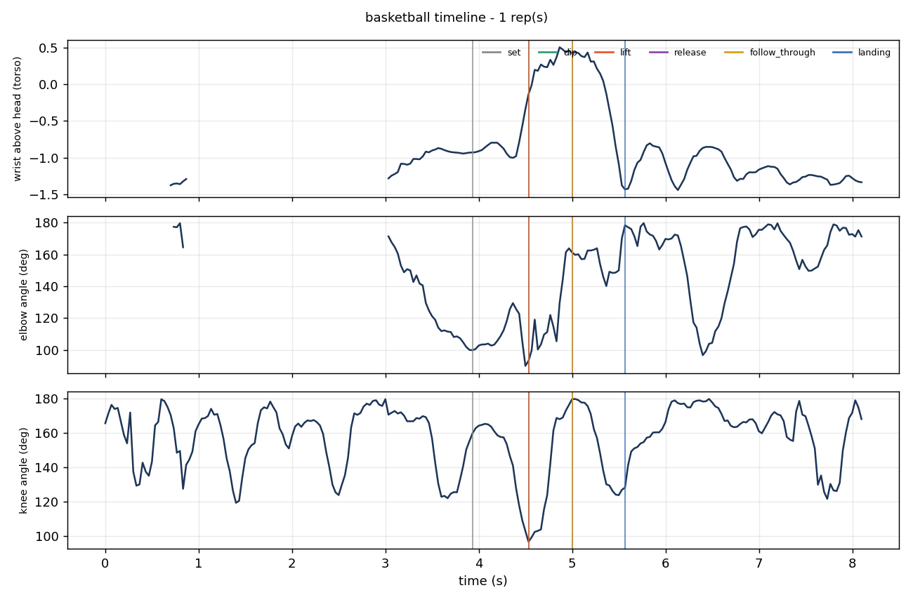
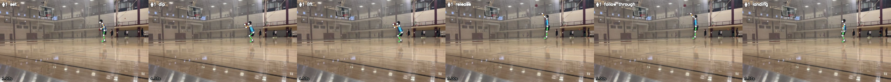

# SwingForm report: basketball (basketball.mp4)

*swingform-ai 0.2.0* | side: **left** | reps detected: **1**

## Capture quality

| Duration | FPS | Resolution | Pose coverage | Mean visibility |
| --- | --- | --- | --- | --- |
| 8.10 s | 30 | 568x320 | 100% | 0.83 |

> **Note:** side=auto picked 'left' (mirrored selfie video flips it).

Overlay video: [overlay.mp4](overlay.mp4)

## Rep 1 - 100% of checks in range

Phases: set 3.93s, dip 4.53s, lift 4.53s, release 5.00s, follow_through 5.00s, landing 5.57s  
Detection confidence: 0.83 (auto)

Timing: set to release s 1.07, dip to release s 0.47

| Check | Value | Reference | Status | Cue |
| --- | --- | --- | --- | --- |
| Elbow extension at release | 161 deg | >= 145 | OK |  |
| Knee bend in the dip | 102 deg | 95 - 160 | OK |  |
| Release height | 0.44 torso | >= 0.2 | OK |  |
| Dip-to-release time | 0.47 s | 0.2 - 0.8 | OK |  |
| Sideways drift | 0.39 torso | <= 0.5 | OK |  |

## How to read this

Metrics are 2D single-camera pose proxies. Reference ranges are broad starter values for spotting outliers, not coaching verdicts. No club, ball-flight or make/miss measurement is performed.
Distances are in torso lengths (shoulder-midpoint to hip-midpoint), so they do not depend on resolution or zoom.
