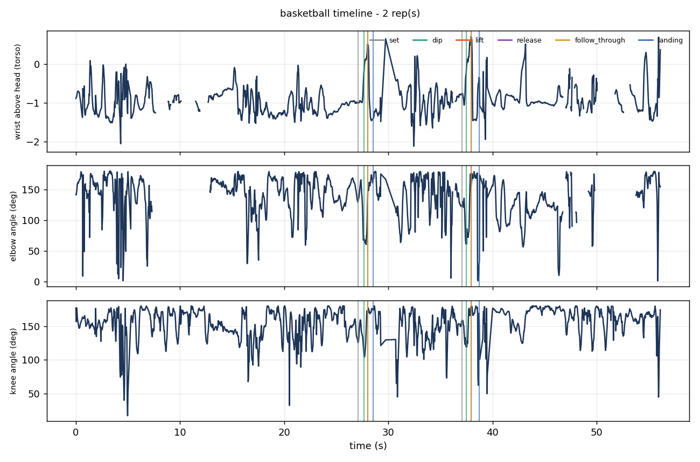
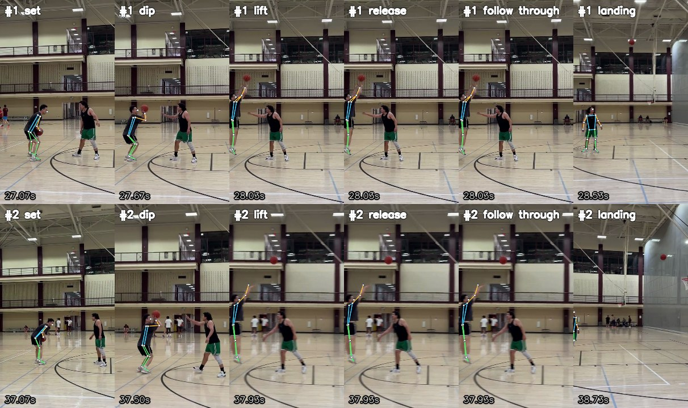

# MotionMirror report: basketball (basketball.mp4)

*motionmirror 0.2.0* | side: **right** | reps detected: **2**

## Capture quality

| Duration | FPS | Resolution | Pose coverage | Mean visibility |
| --- | --- | --- | --- | --- |
| 56 s | 30 | 480x854 | 93% | 0.87 |

> **Note:** side=auto picked 'right' (mirrored selfie video flips it).

Overlay video: [overlay.mp4](overlay.mp4)

## Rep 1 - 80% of checks in range

Phases: set 27.07s, dip 27.67s, lift 28.03s, release 28.03s, follow_through 28.03s, landing 28.53s  
Detection confidence: 0.84 (auto)

Timing: set to release s 0.97, dip to release s 0.37

| Check | Value | Reference | Status | Cue |
| --- | --- | --- | --- | --- |
| Elbow extension at release | 148 deg | >= 145 | OK |  |
| Knee bend in the dip | 106 deg | 95 - 160 | OK |  |
| Release height | 0.47 torso | >= 0.2 | OK |  |
| Dip-to-release time | 0.37 s | 0.2 - 0.8 | OK |  |
| Sideways drift | 0.69 torso | <= 0.5 | HIGH | Hips drift sideways between set and landing; aim to land where you took off. |

## Rep 2 - 80% of checks in range

Phases: set 37.07s, dip 37.50s, lift 37.93s, release 37.93s, follow_through 37.93s, landing 38.73s  
Detection confidence: 0.84 (auto)

Timing: set to release s 0.87, dip to release s 0.43

| Check | Value | Reference | Status | Cue |
| --- | --- | --- | --- | --- |
| Elbow extension at release | 165 deg | >= 145 | OK |  |
| Knee bend in the dip | 120 deg | 95 - 160 | OK |  |
| Release height | 0.61 torso | >= 0.2 | OK |  |
| Dip-to-release time | 0.43 s | 0.2 - 0.8 | OK |  |
| Sideways drift | 2.33 torso | <= 0.5 | HIGH | Hips drift sideways between set and landing; aim to land where you took off. |

## Consistency across reps

| Metric | Mean | Std | Min | Max | n |
| --- | --- | --- | --- | --- | --- |
| release.shooting_elbow_angle_deg | 157 | 8.40 | 148 | 165 | 2 |
| dip.shooting_knee_angle_deg | 113 | 7.05 | 106 | 120 | 2 |
| timing.dip_to_release_s | 0.40 | 0.03 | 0.37 | 0.43 | 2 |
| release.wrist_above_head_torso | 0.54 | 0.07 | 0.47 | 0.61 | 2 |

## How to read this

Metrics are 2D single-camera pose proxies. Reference ranges are broad starter values for spotting outliers, not coaching verdicts. No club, ball-flight or make/miss measurement is performed.
Distances are in torso lengths (shoulder-midpoint to hip-midpoint), so they do not depend on resolution or zoom.
