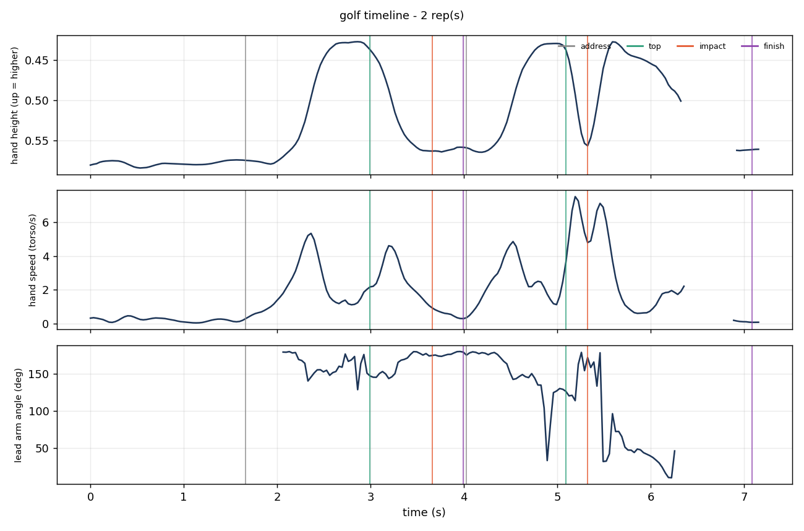
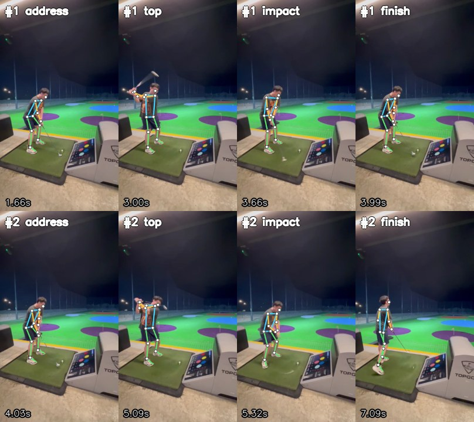

# MotionMirror report: golf (golf.mp4)

*motionmirror 0.2.0* | side: **right** | reps detected: **2**

## Capture quality

| Duration | FPS | Resolution | Pose coverage | Mean visibility |
| --- | --- | --- | --- | --- |
| 7.16 s | 30 | 320x568 | 100% | 0.86 |

> **Note:** Rep 1 ball trail: none
> **Note:** Rep 2 ball trail: none

Overlay video: [overlay.mp4](overlay.mp4)

## Rep 1 - 60% of checks in range

Phases: address 1.66s, top 3.00s, impact 3.66s, finish 3.99s  
Detection confidence: 0.55 (auto)

- downswing 0.67s is outside the usual 0.12-0.6s window
Timing: backswing s 1.33, downswing s 0.67, tempo ratio 2.00, total s 2.33

| Check | Value | Reference | Status | Cue |
| --- | --- | --- | --- | --- |
| Tempo (backswing : downswing) | 2.00:1 | 2 - 4 | LOW | Backswing is quick relative to the downswing; try a smoother, longer takeaway. |
| Lead arm at top | 147 deg | >= 145 | OK |  |
| Hip sway in backswing | 0.07 torso | <= 0.35 | OK |  |
| Head movement to impact | 0.21 torso | <= 0.35 | OK |  |
| Knee flex at address | 134 deg | 135 - 175 | LOW | Very deep knee flex at address; stand a little taller. |

## Rep 2 - 60% of checks in range

Phases: address 4.03s, top 5.09s, impact 5.32s, finish 7.09s  
Detection confidence: 0.84 (auto)

Timing: backswing s 1.06, downswing s 0.23, tempo ratio 4.57, total s 3.06

| Check | Value | Reference | Status | Cue |
| --- | --- | --- | --- | --- |
| Tempo (backswing : downswing) | 4.57:1 | 2 - 4 | HIGH | Downswing is slow relative to the backswing; let the transition accelerate. |
| Lead arm at top | 126 deg | >= 145 | LOW | Lead arm is noticeably bent at the top; a wider arc usually adds consistency. |
| Hip sway in backswing | 0.09 torso | <= 0.35 | OK |  |
| Head movement to impact | 0.19 torso | <= 0.35 | OK |  |
| Knee flex at address | 140 deg | 135 - 175 | OK |  |

## Consistency across reps

| Metric | Mean | Std | Min | Max | n |
| --- | --- | --- | --- | --- | --- |
| timing.tempo_ratio | 3.29 | 1.29 | 2.00 | 4.57 | 2 |
| timing.backswing_s | 1.20 | 0.13 | 1.06 | 1.33 | 2 |
| top.lead_arm_angle_deg | 137 | 10 | 126 | 147 | 2 |
| impact.head_drift_torso | 0.20 | 0.01 | 0.19 | 0.21 | 2 |
| top.hand_height_torso | 0.13 | 0.01 | 0.12 | 0.15 | 2 |

## How to read this

Metrics are 2D single-camera pose proxies. Reference ranges are broad starter values for spotting outliers, not coaching verdicts. No club, ball-flight or make/miss measurement is performed.
Distances are in torso lengths (shoulder-midpoint to hip-midpoint), so they do not depend on resolution or zoom.
