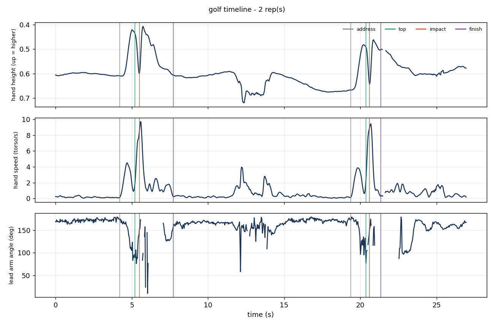
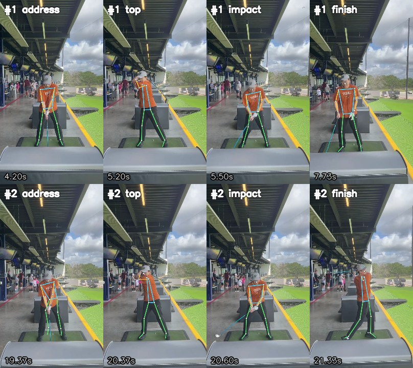

# MotionMirror report: golf (golf.mp4)

*motionmirror 0.2.0* | side: **right** | reps detected: **2**

## Capture quality

| Duration | FPS | Resolution | Pose coverage | Mean visibility |
| --- | --- | --- | --- | --- |
| 27 s | 30 | 720x1280 | 99% | 0.87 |

> **Note:** Rep 1 ball trail: none
> **Note:** Rep 2 ball trail: none

Overlay video: [overlay.mp4](overlay.mp4)

## Rep 1 - 80% of checks in range

Phases: address 4.20s, top 5.20s, impact 5.50s, finish 7.73s  
Detection confidence: 0.87 (auto)

Timing: backswing s 1.00, downswing s 0.30, tempo ratio 3.33, total s 3.53

| Check | Value | Reference | Status | Cue |
| --- | --- | --- | --- | --- |
| Tempo (backswing : downswing) | 3.33:1 | 2 - 4 | OK |  |
| Lead arm at top | 91 deg | >= 145 | LOW | Lead arm is noticeably bent at the top; a wider arc usually adds consistency. |
| Hip sway in backswing | 0.17 torso | <= 0.35 | OK |  |
| Head movement to impact | 0.23 torso | <= 0.35 | OK |  |
| Knee flex at address | 174 deg | 135 - 175 | OK |  |

## Rep 2 - 40% of checks in range

Phases: address 19.37s, top 20.37s, impact 20.60s, finish 21.33s  
Detection confidence: 0.86 (auto)

Timing: backswing s 1.00, downswing s 0.23, tempo ratio 4.29, total s 1.97

| Check | Value | Reference | Status | Cue |
| --- | --- | --- | --- | --- |
| Tempo (backswing : downswing) | 4.29:1 | 2 - 4 | HIGH | Downswing is slow relative to the backswing; let the transition accelerate. |
| Lead arm at top | 104 deg | >= 145 | LOW | Lead arm is noticeably bent at the top; a wider arc usually adds consistency. |
| Hip sway in backswing | 0.23 torso | <= 0.35 | OK |  |
| Head movement to impact | 0.09 torso | <= 0.35 | OK |  |
| Knee flex at address | 176 deg | 135 - 175 | HIGH | Legs are nearly locked at address; add a little knee flex. |

## Consistency across reps

| Metric | Mean | Std | Min | Max | n |
| --- | --- | --- | --- | --- | --- |
| timing.tempo_ratio | 3.81 | 0.48 | 3.33 | 4.29 | 2 |
| timing.backswing_s | 1.00 | 0.00 | 1.00 | 1.00 | 2 |
| top.lead_arm_angle_deg | 98 | 6.53 | 91 | 104 | 2 |
| impact.head_drift_torso | 0.16 | 0.07 | 0.09 | 0.23 | 2 |
| top.hand_height_torso | 0.21 | 0.03 | 0.18 | 0.24 | 2 |

## How to read this

Metrics are 2D single-camera pose proxies. Reference ranges are broad starter values for spotting outliers, not coaching verdicts. No club, ball-flight or make/miss measurement is performed.
Distances are in torso lengths (shoulder-midpoint to hip-midpoint), so they do not depend on resolution or zoom.
